# مخطط صلّحها الآن V6.1

مخطط قاعدة الاختبار بعد ترحيلات الإصدار النهائي. يضم 19 جدولًا وظيفيًا. جداول البنية التشغيلية والتجريبية خارج الرسم.

```mermaid
erDiagram
    users {
        bigint id PK "required"
        varchar first_name "required"
        varchar last_name "required"
        varchar email UK "required"
        varchar password "required"
        varchar phone "required"
        varchar location "required"
        enum gender "required"
        varchar profile_image "nullable"
        enum role "required"
        enum status "required"
        datetime created_at "nullable"
        datetime updated_at "nullable"
        varchar remember_token "nullable"
    }
    vendor_profiles {
        bigint id PK "required"
        bigint user_id FK,UK "required"
        int experience_years "required"
        text bio "required"
        varchar work_type "required"
        varchar work_permit_path "required"
        date permit_expiry_date "required"
        enum application_status "required"
        datetime applied_at "nullable"
        text rejection_reason "nullable"
        datetime created_at "nullable"
        datetime updated_at "nullable"
        tinyint instant_available "required"
        decimal latitude "nullable, decimal(9,6)"
        decimal longitude "nullable, decimal(9,6)"
        datetime location_updated_at "nullable"
        datetime last_seen_at "nullable"
    }
    categories {
        bigint id PK "required"
        varchar name "required"
        text description "required"
        varchar image "required"
        tinyint is_deleted "required"
        datetime created_at "nullable"
        datetime updated_at "nullable"
    }
    services {
        bigint id PK "required"
        bigint category_id FK "required"
        varchar name "required"
        text description "required"
        varchar image "required"
        enum approval_status "required"
        text rejection_reason "nullable"
        tinyint is_deleted "required"
        datetime created_at "nullable"
        datetime updated_at "nullable"
        tinyint is_active "required"
        bigint suggested_by FK "nullable"
        tinyint supports_instant "required"
    }
    vendor_services {
        bigint id PK "required"
        bigint vendor_id FK "required"
        bigint service_id FK "required"
        text description "nullable"
        decimal price "required, decimal(10,3)"
        varchar image "required"
        enum status "required"
        datetime created_at "nullable"
        datetime updated_at "nullable"
        smallint duration_minutes "nullable"
        varchar rejection_reason "nullable"
        tinyint instant_enabled "required"
    }
    recurring_availability {
        bigint id PK "required"
        bigint vendor_id FK "required"
        tinyint day_of_week "required"
        time start_time "required"
        time end_time "required"
        tinyint is_active "required"
        datetime created_at "nullable"
        datetime updated_at "nullable"
    }
    portfolio_projects {
        bigint id PK "required"
        bigint vendor_id FK "required"
        varchar name "required"
        text description "required"
        date completion_date "nullable"
        varchar project_url "nullable"
        datetime created_at "nullable"
        datetime updated_at "nullable"
        decimal project_price "nullable, decimal(10,3)"
        tinyint is_active "required"
    }
    bookings {
        bigint id PK "required"
        bigint customer_id FK "required"
        bigint vendor_service_id FK "required"
        bigint availability_id FK "nullable"
        date booking_date "required"
        time start_time "required"
        time end_time "required"
        varchar service_name "required"
        text service_description "required"
        decimal original_price "required, decimal(10,3)"
        enum status "required"
        datetime approved_at "nullable"
        datetime payment_deadline "nullable"
        datetime completed_at "nullable"
        datetime objection_deadline "nullable"
        datetime cancelled_at "nullable"
        bigint cancelled_by FK "nullable"
        decimal cancellation_penalty "required, decimal(10,3)"
        datetime created_at "nullable"
        datetime updated_at "nullable"
        timestamp deleted_at "nullable"
        datetime customer_completed_at "nullable"
        datetime vendor_completed_at "nullable"
        decimal cancellation_refund_amount "nullable, decimal(10,3)"
        decimal cancellation_platform_share "nullable, decimal(10,3)"
        text completion_description "nullable"
        enum booking_type "required"
        bigint instant_offer_id FK,UK "nullable"
        decimal agreed_price "nullable, decimal(10,3)"
        datetime expected_arrival_at "nullable"
        datetime departed_at "nullable"
        datetime arrived_at "nullable"
        datetime arrival_verified_at "nullable"
        datetime arrival_code_expires_at "nullable"
        datetime arrival_code_locked_until "nullable"
        datetime started_at "nullable"
        datetime settled_at "nullable"
        varchar arrival_code_hash "nullable"
        text arrival_code_encrypted "nullable"
        tinyint arrival_code_failed_attempts "required"
        enum settlement_status "nullable"
    }
    payments {
        bigint id PK "required"
        bigint booking_id FK,UK "required"
        decimal amount "required, decimal(10,3)"
        enum payment_method "nullable"
        enum status "required"
        datetime paid_at "nullable"
        datetime created_at "nullable"
        decimal paid_amount "nullable, decimal(10,3)"
        decimal refunded_amount "nullable, decimal(10,3)"
        datetime refunded_at "nullable"
    }
    wallet_transactions {
        bigint id PK "required"
        bigint booking_id FK "nullable"
        enum transaction_type "required"
        decimal amount "required, decimal(10,3)"
        text description "nullable"
        datetime created_at "nullable"
        bigint user_id FK "nullable"
        bigint related_transaction_id FK "nullable"
        bigint refund_request_id FK "nullable"
        bigint performed_by FK "nullable"
        enum account_type "required"
        enum direction "nullable"
        enum status "nullable; posted, outstanding, repaid or superseded"
        varchar idempotency_key UK "nullable"
        datetime due_at "nullable"
    }
    refund_requests {
        bigint id PK "required"
        bigint booking_id FK "required"
        text reason "required"
        enum status "required"
        text admin_response "nullable"
        decimal refund_amount "nullable, decimal(10,3)"
        datetime reviewed_at "nullable"
        datetime created_at "nullable"
        bigint submitted_by FK "required"
        bigint responsible_user_id FK "nullable"
        bigint beneficiary_id FK "nullable"
        enum case_type "required"
        decimal compensation_amount "nullable, decimal(10,3)"
        decimal approved_service_amount "nullable, decimal(10,3)"
        enum compensation_status "nullable"
        datetime compensation_due_at "nullable"
        bigint reviewed_by FK "nullable"
        bigint ordinary_objection_booking_id UK "generated, nullable for exceptional cases"
    }
    reviews {
        bigint id PK "required"
        bigint booking_id FK "required"
        bigint reviewer_id FK "required"
        bigint reviewed_user_id FK "required"
        tinyint rating "required"
        text comment "nullable"
        datetime created_at "nullable"
        tinyint is_active "required"
    }
    favorites {
        bigint id PK "required"
        bigint customer_id FK "required"
        bigint vendor_service_id FK "required"
        datetime created_at "nullable"
    }
    notifications {
        bigint id PK "required"
        bigint user_id FK "required"
        varchar title "required"
        text message "required"
        enum type "required"
        tinyint is_read "required"
        datetime created_at "nullable"
    }
    contact_messages {
        bigint id PK "required"
        bigint sender_id FK "required"
        varchar subject "required"
        text message "required"
        enum status "required"
        datetime reviewed_at "nullable"
        datetime created_at "nullable"
    }
    instant_requests {
        bigint id PK "required"
        bigint customer_id FK "required"
        bigint service_id FK "required"
        text description "required"
        varchar address "required"
        decimal latitude "required, decimal(9,6)"
        decimal longitude "required, decimal(9,6)"
        enum status "required"
        datetime expires_at "required"
        timestamp created_at "nullable"
        timestamp updated_at "nullable"
    }
    instant_offers {
        bigint id PK "required"
        bigint instant_request_id FK "required"
        bigint vendor_service_id FK "required"
        decimal offered_price "required, decimal(10,3)"
        int arrival_minutes "required"
        int duration_minutes "required"
        enum status "required"
        timestamp created_at "nullable"
        timestamp updated_at "nullable"
    }
    images {
        bigint id PK "required"
        bigint booking_id FK "nullable"
        varchar kind "required"
        varchar path "required"
        bigint project_id FK "nullable"
        bigint review_id FK "nullable"
        bigint instant_request_id FK "nullable"
        bigint refund_request_id FK "nullable"
        bigint uploaded_by FK "nullable"
        tinyint is_active "required"
        datetime created_at "nullable"
        bigint legacy_portfolio_id UK "nullable"
    }
    booking_events {
        bigint id PK "required"
        bigint booking_id FK "required"
        bigint performed_by FK "nullable"
        bigint resolved_by FK "nullable"
        enum event_type "required"
        enum status_type "nullable"
        varchar previous_status "nullable"
        varchar new_status "nullable"
        decimal previous_price "nullable, decimal(10,3)"
        decimal proposed_price "nullable, decimal(10,3)"
        enum adjustment_status "nullable"
        decimal latitude "nullable, decimal(9,6)"
        decimal longitude "nullable, decimal(9,6)"
        text description "nullable"
        datetime resolved_at "nullable"
        timestamp created_at "required"
    }
    recurring_availability o|--o{ bookings : availability_id
    users o|--o{ bookings : cancelled_by
    users ||--o{ bookings : customer_id
    instant_offers o|--o| bookings : instant_offer_id
    vendor_services ||--o{ bookings : vendor_service_id
    bookings ||--o{ booking_events : booking_id
    users o|--o{ booking_events : performed_by
    users o|--o{ booking_events : resolved_by
    users ||--o{ contact_messages : sender_id
    users ||--o{ favorites : customer_id
    vendor_services ||--o{ favorites : vendor_service_id
    bookings o|--o{ images : booking_id
    instant_requests o|--o{ images : instant_request_id
    portfolio_projects o|--o{ images : project_id
    refund_requests o|--o{ images : refund_request_id
    reviews o|--o{ images : review_id
    users o|--o{ images : uploaded_by
    instant_requests ||--o{ instant_offers : instant_request_id
    vendor_services ||--o{ instant_offers : vendor_service_id
    users ||--o{ instant_requests : customer_id
    services ||--o{ instant_requests : service_id
    users ||--o{ notifications : user_id
    bookings ||--o| payments : booking_id
    users ||--o{ portfolio_projects : vendor_id
    users ||--o{ recurring_availability : vendor_id
    users o|--o{ refund_requests : beneficiary_id
    bookings ||--o{ refund_requests : booking_id
    users o|--o{ refund_requests : responsible_user_id
    users o|--o{ refund_requests : reviewed_by
    users ||--o{ refund_requests : submitted_by
    bookings ||--o{ reviews : booking_id
    users ||--o{ reviews : reviewed_user_id
    users ||--o{ reviews : reviewer_id
    categories ||--o{ services : category_id
    users o|--o{ services : suggested_by
    users ||--o| vendor_profiles : user_id
    services ||--o{ vendor_services : service_id
    users ||--o{ vendor_services : vendor_id
    bookings o|--o{ wallet_transactions : booking_id
    users o|--o{ wallet_transactions : performed_by
    refund_requests o|--o{ wallet_transactions : refund_request_id
    wallet_transactions o|--o{ wallet_transactions : related_transaction_id
    users o|--o{ wallet_transactions : user_id
```

## قيود التفرد المركّبة

- `favorites` على `customer_id,vendor_service_id`.
- `instant_offers` على `instant_request_id,vendor_service_id`.
- `reviews` على `booking_id,reviewer_id`.

قيد images_primary_parent_check يفرض أن للصورة مالكًا أساسيًا واحدًا وأن نوعها يطابقه. مشاركة مسار الملف مسموحة.
